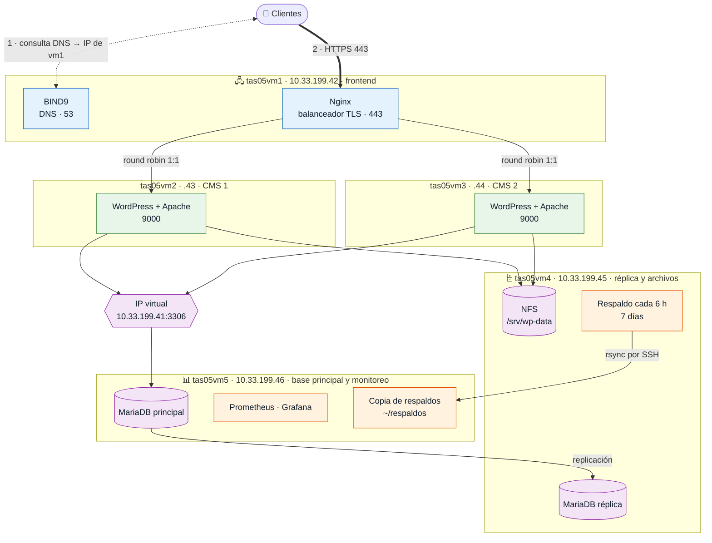

# TAS - Nodo Sur — Plataforma digital resiliente

**Asignatura:** EIN-090B · Taller de Administración de Sistemas

**Colaboradores:**

- Cristobal Vergara
- Javier Ulloa
- Martin Villaroel

---
## 1. Descripción del Proyecto

El proyecto tiene como propósito transformar un problema empresarial en una plataforma operable. El objetivo principal no es solamente instalar un CMS y mostrar su portada, sino construir una solución robusta que pueda ser publicada, administrada, diagnosticada, mantenida y recuperada ante posibles fallas. 

Para lograr esto, el equipo, deberán actuar como un proveedor de infraestructura. En este rol es fundamental justificar cada decisión técnica y sobre la arquitectura, mediante el establecimiento de requerimientos, la ejecución de pruebas, la recolección de métricas, el análisis de logs y la creación de procedimientos que sean completamente reproducibles.  

---
## 2. Fechas

| Entrega | Fecha     | Descripción                                |
| :-------: | :-----: | :----------------------------------------- |
| 1       | 05/09     | Informe de requerimientos y arquitectura   |
| 2       | 05/09     | CMS funcional                              |
| 3       | 23/10     | Publicación resiliente y seguridad         |
| 4       | -/-       | Observabilidad y continuidad operacional   |
| 5       | -/-       | Defensa fina, auditoria e incidentes       |

---
## 3. Arquitectura

Cinco VM en la red interna `10.33.199.40/29`. La mayoría de los servicios corren en contenedores Docker; MariaDB, NFS, keepalived y `node_exporter` van instalados directamente. La base de datos se replica entre vm4 y vm5 y se accede por la IP virtual `10.33.199.41`.

| VM         | Rol                                | IP           | Servicios principales                                   |
| ---------- | ---------------------------------- | ------------ | ------------------------------------------------------- |
| `tas05vm1` | DNS y balanceador                  | 10.33.199.42 | BIND9 (53), Nginx HTTPS (80/443)                        |
| `tas05vm2` | CMS 1                              | 10.33.199.43 | WordPress con Apache (9000)                             |
| `tas05vm3` | CMS 2                              | 10.33.199.44 | WordPress con Apache (9000)                             |
| `tas05vm4` | Réplica de la base, NFS, respaldos | 10.33.199.45 | MariaDB réplica (3306), NFS `/srv/wp-data`, keepalived  |
| `tas05vm5` | Base principal y monitoreo         | 10.33.199.46 | MariaDB principal (3306), keepalived, Prometheus, Grafana (métricas), copia de respaldos |



> **Corrección:** en la arquitectura incluimos por error Alertmanager y Blackbox exporter en `tas05vm5`. Esos servicios no forman parte del sistema desplegado; el monitoreo se compone solo de Prometheus y Grafana. El error se corrigió después de la entrega del informe, por lo que el informe entregado aún los menciona.

Detalle de puertos, firewall, respaldos y puntos únicos de falla en [`infraestructura/infraestructura.md`](infraestructura/infraestructura.md).

---
## 4. Estructura del repositorio

```
.
├── bitacora/
│   ├── 01-servidores/           # Paso a paso de cada instalación (VM, Docker, DNS, MariaDB,
│   │                            # WordPress + NFS, balanceador HTTPS, monitoreo, respaldos)
│   ├── 02-repositorio/          # Registro de trabajo sobre el repositorio
│   ├── 03-situaciones_de_error/ # Incidentes y su resolución
│   └── 04-pruebas/              # Pruebas de funcionamiento y sus resultados
├── decisiones/                  # Registros de decisiones técnicas (estructura, Docker,
│                                # balanceador, servidor web)
├── docs/informe/                # Informe del proyecto (PDF) y entregas
├── infraestructura/             # Distribución de nodos, flujo, firewall y respaldos
└── README.md
```

---
## 5. Declaración de uso de Inteligencia artificial

| Herramienta | Propósito | Fragmento relevante | Validación realizada | Cambios aplicados |
|---|---|---|---|---|
| Claude | Apoyo en redacción, estructura y corrección del informe, del README y de la documentación de scripts | Tablas de requerimientos con umbrales, política de datos, cálculo de capacidad N-1 y documentación de la configuración de Docker, NFS y monitorización | A completar por el equipo: revisar cada cifra y comando y contrastarlo con pruebas y documentación oficial | A completar por el equipo |

_Nota: la respuesta de una IA no constituye evidencia técnica. Todo código o comando debe poder ser explicado por cualquier integrante del equipo._

---
